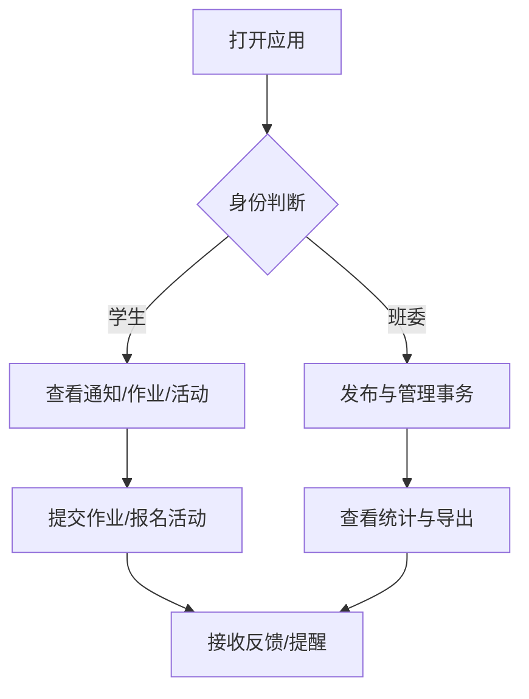

# 校园班级事务智能管理助手 - 产品需求文档

## 1. 产品概述

校园班级事务智能管理助手是一款面向高校班级学生、班委成员的移动端 Web 应用，旨在将通知、签到、作业、活动、投票、班费等班级事务从混乱的群聊中抽离出来，按事务类型分类聚合，实现统一、清晰、高效的班级事务管理。

目标用户为高校在读学生及班委（班长、团支书、学委、副班长、生活委员、体委等可自定义角色），核心价值是降低信息查找成本、提高班委工作效率、增强班级事务透明度。

## 2. 核心功能

### 2.1 用户角色

| 角色 | 权限说明 |
|------|----------|
| 普通学生 | 查看通知、提交作业、报名活动、查看考勤、查看班费、参与投票 |
| 班委成员 | 发布通知/作业/活动/投票、登记缴费、记账、管理报名信息、查看统计报表 |
| 班长/管理员 | 班级设置、成员导入、角色分配、档案导出 |

### 2.2 功能模块

1. **班级设置与个人中心**：设置入口、个人信息、再次提醒设置、关于、账号安全、隐私设置等
2. **通知与互动消息**：通知分类展示、未读红点、消息列表
3. **考勤管理**：我的考勤记录、考勤状态筛选
4. **作业管理**：我的作业、作业列表、发布作业、作业详情、作业提交、延时申请
5. **活动管理**：我的活动、活动列表、发布活动、活动详情、报名表单、报名统计、我的报名
6. **投票管理**：投票列表、投票详情/结果
7. **班费管理**：班费账本、班费记账、收支报表、缴费登记
8. **班级档案**：班级电子档案、档案详情、导出档案
9. **任务管理**：任务看板、进度跟踪

### 2.3 页面清单

| 页面名称 | 所属模块 | 功能描述 |
|----------|----------|----------|
| 设置 | 个人中心 | 总设置入口，分组展示账号安全、通知设置、通用设置、帮助反馈 |
| 个人信息页 | 个人中心 | 头像、姓名、班级身份、基础信息编辑 |
| 再次提醒设置页 | 个人中心 | 按场景开关提醒并设置提前时长 |
| 关于页 | 个人中心 | 应用 Logo、版本、协议与评分入口 |
| 我的考勤 | 考勤 | 查看个人考勤记录与状态 |
| 我的作业 | 作业 | 学生视角作业列表与状态 |
| 我的活动 | 活动 | 我参与/报名的活动列表 |
| 我的报名页 | 活动 | 我的报名记录与审核状态 |
| 作业列表页 | 作业 | 班委端作业管理列表 |
| 投票列表页 | 投票 | 投票卡片列表与进度 |
| 活动列表页 | 活动 | 活动大图卡片列表与报名 |
| 班级电子档案页 | 档案 | 按学年展示班级档案 |
| 发布作业页 | 作业 | 班委发布作业表单 |
| 发布活动页 | 活动 | 班委发布活动表单 |
| 报名表单页 | 活动 | 学生填写报名信息 |
| 作业提交页 | 作业 | 学生上传作业附件与补充说明 |
| 延时申请页 | 作业 | 申请作业延时提交 |
| 班费记账页 | 班费 | 记录班费收入/支出 |
| 缴费登记页 | 班费 | 勾选已缴费人员名单 |
| 任务看板 | 任务 | 任务数据概览与进度列表 |
| 报名统计页 | 活动 | 报名数据汇总与人员审核 |
| 收支报表页 | 班费 | 收支总览、月度柱状图、明细列表 |
| 作业详情页 | 作业 | 作业基本信息、要求、底部操作 |
| 档案详情页 | 档案 | 档案信息分组、内容预览、导出入口 |
| 活动详情页 | 活动 | 活动封面、信息分组、报名操作 |
| 班费账本页 | 班费 | 余额展示、时间筛选、收支明细 |
| 互动消息页 | 消息 | 消息分类标签、会话列表与未读红点 |

## 3. 核心流程

主要用户流程包括：学生查看通知→查看作业/活动→提交作业/报名活动；班委发布通知/作业/活动→查看统计→管理报名/缴费；管理员维护班级成员与角色→导出档案。

## 4. 用户界面设计

### 4.1 设计风格

- **色彩体系**：以蓝色为主基调，使用两套渐变差异化配色
  - 深正式渐变（A组）：#076CAB → #32C9FD → #DEFCFF，用于管理/数据/正式类页面
  - 浅清新渐变（B组）：#1986E6 → #8ACAE5 → #DEFCFF，用于工具/日常/列表类页面
- **顶部头部**：单块完整渐变头部区块，从屏幕最顶端无缝延伸至底部大圆角边缘，状态栏、返回箭头、页面标题、装饰图标内嵌于同一块渐变背景
- **组件规范**：基于 shadcn/ui 组件体系；图标统一使用 lucide-react（Tabler 风格）
- **字体**：标题 Funnel Sans、正文 Inter、辅助小字 Geist、数据 Geist Mono
- **质感与层级**：impeccable 3D 规范 + taste-skill 审美层级；8px 基础栅格；Basic Roundness 圆角；Gentle Lift 柔和阴影
- **布局范式**：分组列表、横向卡片、表单单列、数据概览+列表、封面图+信息分组

### 4.2 页面设计概述

| 页面分类 | 复用范式 | 包含页面 |
|----------|----------|----------|
| 分组设置类 | 班级设置页分组列表 | 设置、个人信息、再次提醒设置、关于 |
| 列表展示类 | 文件列表页横向卡片 | 我的考勤、我的作业、我的活动、我的报名、作业列表、投票列表、活动列表、班级电子档案 |
| 表单操作类 | 导出档案页/帮助反馈页表单 | 发布作业、发布活动、报名表单、作业提交、延时申请、班费记账、缴费登记 |
| 统计数据类 | 下载统计页数据可视化 | 任务看板、报名统计、收支报表 |
| 详情展示类 | 分组卡片分层排版 | 作业详情、档案详情、活动详情、班费账本、互动消息 |

### 4.3 响应式设计

- 以移动端优先，基准视口宽度 393px（iPhone 14 Pro）
- 在桌面端以居中手机外壳容器展示，最大宽度 430px
- 所有间距、圆角、字号使用相对单位或 Tailwind 工具类，保证在不同尺寸下比例一致
- 触摸目标最小 44px，保证移动端可点击性

### 4.4 交互说明

- 页面切换使用路由跳转，底部/顶部返回按钮可返回上一页
- 列表项、卡片、按钮均有 hover/active 状态反馈
- 表单输入实时校验与错误提示
- 开关、筛选标签、单选/复选组件状态即时响应
- 未读消息、待办任务通过红点/数字角标提示
