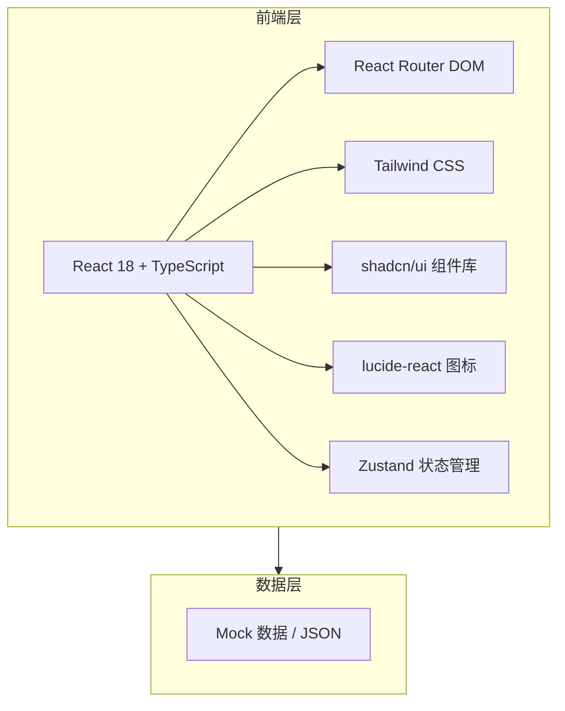

# 校园班级事务智能管理助手 - 技术架构文档

## 1. 架构设计



## 2. 技术选型

* **前端框架**：React 18 + TypeScript

* **构建工具**：Vite 5

* **样式方案**：Tailwind CSS 3

* **UI 组件库**：shadcn/ui（基于 Radix UI + Tailwind）

* **图标库**：lucide-react

* **路由**：react-router-dom

* **状态管理**：zustand

* **字体**：Funnel Sans（标题）、Inter（正文）、Geist（辅助）、Geist Mono（数据）

## 3. 目录结构

```
front/
├── public/                 # 静态资源
│   └── fonts/              # 字体文件
├── src/
│   ├── components/         # 公共组件
│   │   ├── ui/             # shadcn/ui 基础组件
│   │   ├── UnifiedHeader.tsx   # 统一渐变头部
│   │   ├── StatusBar.tsx       # 状态栏
│   │   ├── GroupCard.tsx       # 分组卡片
│   │   ├── ListItem.tsx        # 列表项
│   │   ├── FilterTabs.tsx      # 筛选标签
│   │   ├── FormField.tsx       # 表单字段
│   │   ├── PrimaryButton.tsx   # 主按钮
│   │   └── PhoneFrame.tsx      # 手机外壳容器
│   ├── pages/              # 页面组件
│   │   ├── Settings.tsx
│   │   ├── Profile.tsx
│   │   ├── ReminderSettings.tsx
│   │   ├── About.tsx
│   │   ├── MyAttendance.tsx
│   │   ├── MyHomework.tsx
│   │   ├── MyActivities.tsx
│   │   ├── MyRegistration.tsx
│   │   ├── HomeworkList.tsx
│   │   ├── VoteList.tsx
│   │   ├── ActivityList.tsx
│   │   ├── ClassArchive.tsx
│   │   ├── PublishHomework.tsx
│   │   ├── PublishActivity.tsx
│   │   ├── RegistrationForm.tsx
│   │   ├── HomeworkSubmit.tsx
│   │   ├── DelayApply.tsx
│   │   ├── FeeRecord.tsx
│   │   ├── PaymentRegister.tsx
│   │   ├── TaskBoard.tsx
│   │   ├── RegistrationStats.tsx
│   │   ├── FinanceReport.tsx
│   │   ├── HomeworkDetail.tsx
│   │   ├── ArchiveDetail.tsx
│   │   ├── ActivityDetail.tsx
│   │   ├── FeeLedger.tsx
│   │   └── Messages.tsx
│   ├── hooks/              # 自定义 Hooks
│   ├── stores/             # Zustand 状态仓库
│   ├── data/               # Mock 数据
│   ├── lib/                # 工具函数
│   ├── styles/             # 全局样式与 CSS 变量
│   ├── App.tsx             # 根组件
│   └── main.tsx            # 入口文件
├── index.html
├── package.json
├── tailwind.config.js
├── tsconfig.json
└── vite.config.ts
```

## 4. 路由定义

| 路由                  | 页面       |
| ------------------- | -------- |
| /                   | 设置（默认首页） |
| /settings           | 设置       |
| /profile            | 个人信息     |
| /reminder-settings  | 再次提醒设置   |
| /about              | 关于       |
| /my-attendance      | 我的考勤     |
| /my-homework        | 我的作业     |
| /my-activities      | 我的活动     |
| /my-registration    | 我的报名     |
| /homework-list      | 作业列表     |
| /vote-list          | 投票列表     |
| /activity-list      | 活动列表     |
| /class-archive      | 班级电子档案   |
| /publish-homework   | 发布作业     |
| /publish-activity   | 发布活动     |
| /registration-form  | 报名表单     |
| /homework-submit    | 作业提交     |
| /delay-apply        | 延时申请     |
| /fee-record         | 班费记账     |
| /payment-register   | 缴费登记     |
| /task-board         | 任务看板     |
| /registration-stats | 报名统计     |
| /finance-report     | 收支报表     |
| /homework-detail    | 作业详情     |
| /archive-detail     | 档案详情     |
| /activity-detail    | 活动详情     |
| /fee-ledger         | 班费账本     |
| /messages           | 互动消息     |

## 5. 设计系统变量

### 5.1 颜色

```css
--gradient-a: linear-gradient(180deg, #076CAB 0%, #32C9FD 55%, #DEFCFF 100%);
--gradient-b: linear-gradient(180deg, #1986E6 0%, #8ACAE5 55%, #DEFCFF 100%);
--primary: #1986E6;
--primary-dark: #076CAB;
--surface: #FFFFFF;
--bg: #F8FAFC;
--text-primary: #1E293B;
--text-secondary: #64748B;
--text-muted: #94A3B8;
--border: #E2E8F0;
--shadow-soft: 0 2px 8px rgba(0, 0, 0, 0.08);
```

### 5.2 字体

* 标题：Funnel Sans, sans-serif

* 正文：Inter, sans-serif

* 辅助：Geist, sans-serif

* 数据：Geist Mono, monospace

### 5.3 间距

* 基础栅格 8px

* 页面水平内边距 20px

* 卡片内边距 16px

* 分组间距 24px

* 元素间距 8px / 12px / 16px / 20px

## 6. 数据模型

使用 Mock 数据驱动前端展示，主要数据结构包括：

* User：用户基本信息、角色

* Notification：通知标题、时间、地点、内容、已读状态

* Homework：作业名称、班级、截止时间、要求、提交状态

* Activity：活动名称、时间、地点、详情、报名状态

* Vote：投票标题、剩余时间、参与人数、选项与进度

* FeeRecord：收支类型、金额、分类、备注、时间

* Archive：档案名称、学年、生成时间、类型

* Task：任务名称、负责人、截止时间、进度

* Message：消息分类、标题、预览、时间、未读状态

