# 校园班级事务智能管理助手 — 页面流程图

本文档梳理 `校园班级事务智能管理助手.pen` 中各页面的跳转关系与先后顺序。

---

## 流程图

```mermaid
flowchart TD
    %% 入口与认证
    Start([启动页]) --> Login[登录注册页]
    Login --> Reg[注册页]
    Login --> Identity[身份选择页]
    Reg --> Login
    Identity --> JoinClass[创建加入班级页]
    JoinClass --> Home[学生首页 / 班级首页]

    %% 核心首页 → 各业务模块
    Home --> Notify[通知首页]
    Home --> Attendance[我的考勤]
    Home --> Homework[我的作业]
    Home --> Activity[我的活动]
    Home --> Vote[投票列表页]
    Home --> Fee[班费账本页]
    Home --> Task[任务看板]
    Home --> Data[数据看板页]
    Home --> Profile[个人中心]

    %% 个人中心与设置
    Profile --> Settings[设置]
    Profile --> PersonalInfo[个人信息页]
    Settings --> Reminder[再次提醒设置页]
    Settings --> Account[账号与安全页]
    Settings --> NotifySettings[消息通知设置页]
    Settings --> Privacy[隐私设置页]
    Settings --> General[通用设置页]
    Settings --> Help[帮助与反馈页]
    Settings --> About[关于页]

    %% 通知模块
    Notify --> NotifyList[通知列表页]
    NotifyList --> NotifyDetail[通知详情页]
    NotifyList --> PublishNotify[发布通知页]
    Notify --> NotifyStats[通知统计页]
    Notify --> Messages[互动消息页]

    %% 考勤模块
    Attendance --> AttendanceList[考勤列表页]
    AttendanceList --> CheckIn[发起签到页]
    CheckIn --> CheckInMethod[签到方式选择页]
    AttendanceList --> SignPage[签到页面]
    AttendanceList --> AttendanceDetail[考勤详情页]
    AttendanceList --> LeaveApply[请假申请页]
    AttendanceList --> LeaveApprove[请假审批页]
    AttendanceList --> AttendanceReport[考勤报表页]

    %% 作业模块
    Homework --> HomeworkList[作业列表页]
    HomeworkList --> HomeworkDetail[作业详情页]
    HomeworkDetail --> HomeworkSubmit[作业提交页]
    HomeworkDetail --> DelayApply[延时申请页]
    HomeworkList --> PublishHomework[发布作业页]

    %% 活动与报名模块
    Activity --> ActivityList[活动列表页]
    ActivityList --> ActivityDetail[活动详情页]
    ActivityList --> PublishActivity[发布活动页]
    ActivityDetail --> MyRegistration[我的报名页]
    MyRegistration --> RegistrationForm[报名表单页]
    ActivityList --> RegistrationStats[报名统计页]
    Activity --> MyRegistrationRecord[我的报名记录]

    %% 投票模块
    Vote --> PublishVote[发起投票页]

    %% 班费模块
    Fee --> FeeRecord[班费记账页]
    Fee --> FinanceReport[收支报表页]
    Fee --> PaymentRegister[缴费登记页]

    %% 数据与档案
    Data --> SemesterReport[学期报表页]
    Home --> ClassArchive[班级电子档案页]
    ClassArchive --> ArchiveDetail[档案详情页]
    ClassArchive --> FileList[文件列表页]
    FileList --> DownloadStats[下载统计页]
    ClassArchive --> ExportArchive[导出档案页]

    %% 班级管理
    Home --> ClassManage[班级管理]
    ClassManage --> ClassSettings[班级设置页]
    ClassManage --> ImportStudents[导入学生名单页]
    ClassManage --> MemberList[成员列表页]
    ClassManage --> RoleManage[自定义班委角色页]
    ClassManage --> Handover[工作交接页]
    MemberList --> MemberDetail[成员详情页]
    RoleManage --> RolePermission[角色权限管理页]
    RoleManage --> AddCadre[新增班委页]

    %% 资料库
    Home --> Materials[资料库页]
    Materials --> UploadMaterial[上传资料页]
    Materials --> MaterialDetail[资料详情页]

    %% 任务工具
    Task --> Focus[番茄钟专注页]
    Task --> Lottery[随机抽签页]

    %% 样式
    classDef entry fill:#1986E6,stroke:#076CAB,stroke-width:2px,color:#fff
    classDef home fill:#32C9FD,stroke:#076CAB,stroke-width:2px,color:#fff
    classDef list fill:#EBF4FF,stroke:#1986E6,stroke-width:1px,color:#1E293B
    classDef action fill:#FEF3C7,stroke:#F59E0B,stroke-width:1px,color:#1E293B
    class Start,Login,Reg,Identity,JoinClass entry
    class Home,Profile entry
    class Notify,Attendance,Homework,Activity,Vote,Fee,Task,Data,ClassManage,Materials home
    class NotifyList,AttendanceList,HomeworkList,ActivityList,FileList,MemberList,Materials list
    class PublishNotify,CheckIn,PublishHomework,PublishActivity,PublishVote,FeeRecord,PaymentRegister,UploadMaterial,LeaveApply action
```



---

## 图例说明

| 颜色 | 含义 | 示例 |
| --- | --- | --- |
| 深蓝 | 入口/认证页 | 启动页、登录注册页、注册页、身份选择页 |
| 浅蓝 | 首页/核心导航 | 学生首页、班级首页、个人中心、各业务首页 |
| 浅蓝底 | 列表/汇总页 | 通知列表页、作业列表页、活动列表页 |
| 橙黄底 | 表单/操作页 | 发布通知页、发布作业页、请假申请页 |

---

## 核心流程说明

### 1. 入口与认证流程

```
启动页 → 登录注册页 → 注册页 / 身份选择页 → 创建加入班级页 → 学生首页/班级首页
```

- 未注册用户可进入「注册页」，注册完成后返回登录。
- 已登录用户经过「身份选择页」和「创建加入班级页」后进入首页。

### 2. 首页分发流程

「学生首页 / 班级首页」作为应用核心枢纽，向下分发到各业务模块：

- 通知：通知首页
- 考勤：我的考勤
- 作业：我的作业
- 活动：我的活动
- 投票：投票列表页
- 班费：班费账本页
- 任务：任务看板
- 数据：数据看板页
- 个人：个人中心

### 3. 业务模块通用模式

各业务模块基本遵循 **「列表 → 详情 → 操作」** 的三层结构：

```
业务首页 → 列表页 → 详情页 → 提交/发布/申请表单
```

例如作业模块：

```
我的作业 → 作业列表页 → 作业详情页 → 作业提交页 / 延时申请页
         ↓
      发布作业页
```

### 4. 班级管理流程

```
班级管理 → 班级设置页
        → 导入学生名单页
        → 成员列表页 → 成员详情页
        → 自定义班委角色页 → 角色权限管理页 / 新增班委页
        → 工作交接页
```

### 5. 档案与资料流程

```
班级电子档案页 → 档案详情页
               → 文件列表页 → 下载统计页
               → 导出档案页

资料库页 → 上传资料页
        → 资料详情页
```

### 6. 个人中心与设置流程

```
个人中心 → 设置 → 个人信息页 / 再次提醒设置页 / 账号与安全页
                  / 消息通知设置页 / 隐私设置页 / 通用设置页
                  / 帮助与反馈页 / 关于页
```

---

## 页面总数

`校园班级事务智能管理助手.pen` 中约包含 **70+** 个业务页面/画板，加上 `Phone Frame`、`Button Primary`、`Button Secondary`、`Input Field`、`List Item`、`Tab Bar` 等 6 个可复用组件和 1 个「设计规范」画板。
