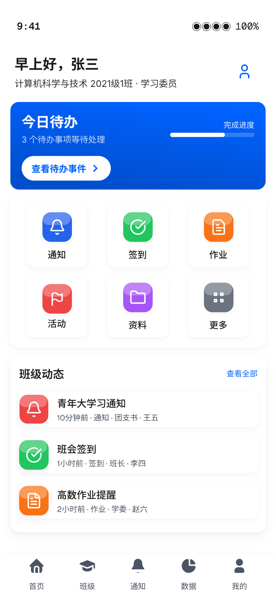
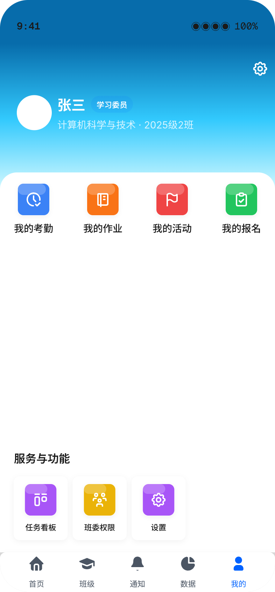
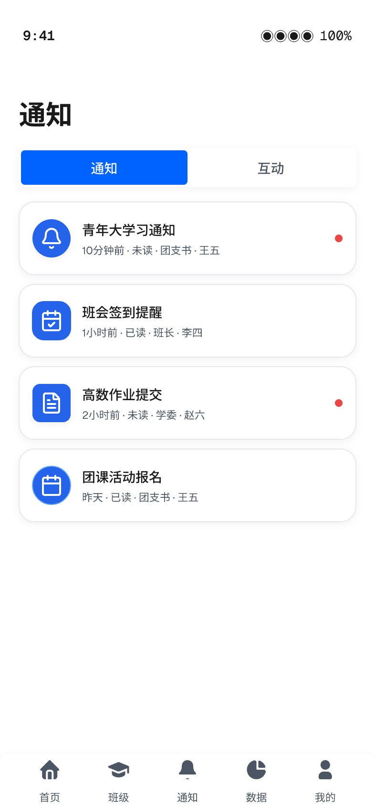
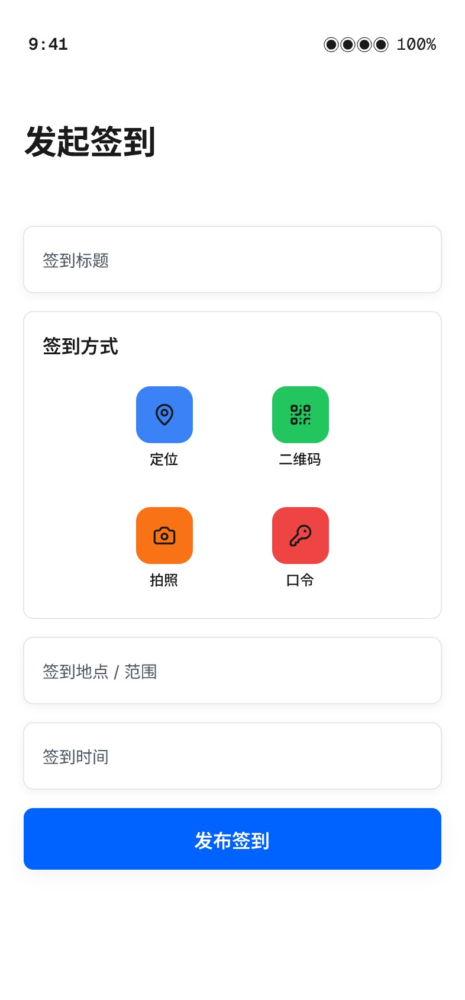

# 班务星 App 技术文档
## 校园班级事务智能管理助手

| 项目信息 | 内容 |
|---|---|
| 项目名称 | 班务星 App（校园班级事务智能管理助手） |
| 参赛赛事 | 第九届传智杯全国大学生计算机能力挑战赛 |
| 参赛赛道 | AI 创新应用挑战赛 · Vibe Coding 挑战赛 |
| 参赛形式 | 个人赛（B 组） |
| 代码仓库 | https://github.com/LZN-0112/ClassStar-APP-Contest |
| 技术形态 | 后端服务 + 移动端 Web 应用 + 微信小程序 + Android 应用 |
| 文档版本 | V1.0 |
| 编写日期 | 2026 年 10 月 |

---

## 目录

- 第一章 问题与方案
  - 1.1 项目背景与痛点
  - 1.2 目标用户与角色模型
  - 1.3 需求拆解与功能规划
  - 1.4 解决方案总览
  - 1.5 创新点与设计亮点
- 第二章 架构与实现
  - 2.1 技术选型
  - 2.2 总体架构
  - 2.3 后端架构与核心机制
  - 2.4 数据模型设计
  - 2.5 Web 端实现
  - 2.6 微信小程序端实现
  - 2.7 Android 打包与真机适配
  - 2.8 工程质量与测试体系
  - 2.9 安全与隐私
- 第三章 AI 协作过程
  - 3.1 协作模式总览
  - 3.2 核心功能 Prompt 链
  - 3.3 提示词工程范式
  - 3.4 意图控制机制
  - 3.5 产出量化与可复现性
- 附录
  - 附录 A 交付物清单
  - 附录 B 演示账号
  - 附录 C 项目目录结构

---

# 第一章 问题与方案

## 1.1 项目背景与痛点

高校班级（及社团）日常事务具有"高频、琐碎、强时效、多角色"四个特征：通知要触达每一个人并确认已读，签到要防代签、要能覆盖请假审批，作业要发布、提交、催交并统计，班费要收支透明、账目可查，活动与评优要组织报名和投票……这些事务长期依赖"微信群 + 纸质表格 + Excel + 口头传达"的组合，存在五个典型痛点：

| 痛点 | 具体表现 | 造成的后果 |
|---|---|---|
| 信息碎片化 | 通知散落在多个群聊，重要通知被刷屏淹没 | 同学漏看、漏报，班委反复催 |
| 数据不沉淀 | 签到、作业、班费多为纸质或 Excel，学期结束即散失 | 无班级档案，无法回溯与统计 |
| 过程不透明 | 班费收支只有班委一人知晓 | 同学信任成本高，易生矛盾 |
| 统计靠手工 | 出勤率、提交率、缴费率靠人工汇总 | 耗时易错，班委负担重 |
| 工具不统一 | 签到用一个小程序、投票用另一个、班费用表格 | 学习成本高，数据无法互通 |

同时，班级之外的学生组织（社团、学生会、兴趣小组）面临同样的管理需求，却几乎没有适合的轻量工具。**因此需要一个把"通知—签到—作业—班费—资料—活动—投票—工具"打通的统一平台，并且能够泛化到各类学生组织。**

本项目由参赛者独立完成，全程以 AI 编码助手（Trae）作为主要开发协作方，属于典型的 Vibe Coding 实践：由人负责需求定义、方案决策与验收，由 AI 负责实现与重构。

## 1.2 目标用户与角色模型

系统面向三类核心用户，并以"角色等级 + 自定义角色"的方式实现权限分层：

| 角色 | 典型使用者 | 核心诉求 |
|---|---|---|
| 组织创建者 / 管理员 | 班主任、辅导员 | 掌握全局数据，发布通知与任务，管理成员 |
| 班委 / 干事 | 班长、学委、生活委员、团支书 | 发起签到、发布作业、登记班费、组织活动 |
| 普通成员 | 学生 | 查看通知、签到、提交作业、报名、投票、查班费 |

权限模型不采用硬编码的"教师/学生"二元划分，而是：

- **角色等级**（`owner` / `admin` / `member`）：决定管理权限的强弱；
- **业务角色**（文字标签，如"班长""学习委员"）+ **是否班委**（`is_committee`）：决定可使用的功能入口；
- **自定义角色表**（`class_roles`）：支持组织按需定义角色及其权限 JSON。

这样同一套系统既能管理班级，也能管理社团，无需为不同组织形态改代码。

## 1.3 需求拆解与功能规划

在需求梳理阶段，将班级事务归纳为 **11 个功能中心**，覆盖从成员进入到学期归档的完整闭环：

| 功能中心 | 主要能力 |
|---|---|
| 用户认证中心 | 注册、登录、密码找回、令牌刷新、角色权限 |
| 组织管理中心 | 创建组织、加入组织、成员管理、角色设置、批量导入 |
| 考勤打卡中心 | 发起考勤、二维码/定位/口令/人脸签到、请假申请与审批、出勤报表 |
| 作业任务中心 | 发布作业、提交作业、线下检查、截图检查、延期申请与审批 |
| 通知公告中心 | 发布通知、已读确认、分类统计、转发、编辑撤回、提醒 |
| 活动投票中心 | 活动发布、报名与签到、投票发起、结果统计 |
| 班费财务中心 | 收支记账、缴费登记、预算管理、财务报表、班费公示 |
| 资料共享中心 | 资料上传、分类管理、下载统计、批量上传 |
| 班级工具中心 | 随机抽人、番茄钟、任务看板 |
| 组织档案中心 | 电子档案、文件归档、学期报告、导出 |
| 数据统计中心 | 考勤统计、作业统计、活动统计、班级看板、错误看板 |

## 1.4 解决方案总览

系统采用"**一套后端 + 三端呈现**"的架构：

- **后端**：NestJS + Prisma + MySQL，提供统一的 RESTful API；
- **移动端 Web 应用**：React + Vite 构建，采用移动优先的交互设计，可运行于手机浏览器，也可被 WebView 容器（Android 应用）加载；
- **微信小程序**：使用 Taro 以 React 语法重建，复用同一套后端接口，覆盖小程序生态；
- **Android 应用**：通过 Capacitor 将 Web 应用打包为原生 APK，并针对真机做了沉浸式状态栏与本地联调适配。

核心设计思想是 **"接口统一、数据同源、体验一致"**：三端共享同一套领域模型与 API，避免数据割裂；不同端只在呈现层做适配。

## 1.5 创新点与设计亮点

| 创新点 | 说明 |
|---|---|
| 组织模型泛化 | 用"组织（classes 表）"统一承载班级与社团，通过 `org_type`、`category` 区分形态，一套代码管理多种组织 |
| 多方式考勤 | 二维码、GPS 定位围栏、口令、人脸（截图）多种签到方式并存，配合请假审批闭环 |
| 作业全流程 | 发布 → 提交 → 线下检查 → 截图识别检查 → 延期申请与审批，覆盖真实教学场景 |
| 财务透明 | 班费收支双账、缴费登记、预算与公示，数据对全员可见 |
| 离线降级 | 对象存储（MinIO）不可用时自动回退本地存储，保证功能可用 |
| 错误自愈 | 全局错误上报 + 解决方案知识库，错误看板可直接关联处置方案 |
| AI 协同可复现 | 全过程 Prompt 链留痕（见第三章），他人可按文档与仓库复现开发过程 |

---

# 第二章 架构与实现

## 2.1 技术选型

选型原则：**移动优先、类型安全、开箱即用、单人可维护**。

| 层次 | 技术 | 版本 | 选型理由 |
|---|---|---|---|
| 后端框架 | NestJS | 10 | 模块化、依赖注入、装饰器风格，天然适合按业务域拆分 |
| ORM | Prisma | 5 | Schema 即文档，类型安全，迁移与客户端生成一体化 |
| 数据库 | MySQL | 8 | 关系型事务可靠，校园场景数据强一致 |
| 缓存 | Redis | — | 会话与热点数据加速（可选，缺失时降级） |
| 对象存储 | MinIO | — | 私有化部署，支持预签名直传；不可用时回退本地磁盘 |
| Web 端 | React + Vite + TypeScript | React 18 / Vite 6 | 启动快、构建快、生态成熟 |
| 样式 | Tailwind CSS | 3 | 原子化样式，便于统一设计令牌 |
| 路由 | React Router（HashRouter） | 6 | Hash 路由无需服务端配置，适配 WebView 与静态托管 |
| 容器化打包 | Capacitor | 8 | 将 Web 应用打包为 Android 原生应用，复用同一份代码 |
| 小程序端 | Taro + React | 4.2.1 | React 语法一次开发、多端编译，复用团队技术栈 |
| 包管理 | npm | — | 三端统一，锁定 `package-lock.json` 保证可复现 |

## 2.2 总体架构

系统采用前后端分离的分层架构，整体如下：

```
┌──────────────────────────────────────────────────────────────┐
│                        展示层（客户端）                        │
│  移动端 Web（React+Vite）   Android App（Capacitor+WebView）    │
│                 微信小程序（Taro+React）                       │
└───────────────────────────┬──────────────────────────────────┘
                            │  HTTPS / JSON
┌───────────────────────────┴──────────────────────────────────┐
│                        接入层（API）                           │
│   统一前缀 /api/v1   鉴权守卫 JWT   请求校验   限流   审计日志   │
└───────────────────────────┬──────────────────────────────────┘
┌───────────────────────────┴──────────────────────────────────┐
│                       服务层（NestJS）                         │
│  auth │ classes │ attendances │ homeworks │ messages │ votes  │
│  activities │ fee │ material │ archive │ tasks │ random-draws │
│  pomodoro │ data │ feedback │ settings │ errors              │
└───────────────────────────┬──────────────────────────────────┘
┌───────────────────────────┴──────────────────────────────────┐
│                        数据层                                  │
│   Prisma ORM ── MySQL（主数据）                                │
│   Redis（缓存/会话，可选）   MinIO / 本地磁盘（文件，可降级）    │
└──────────────────────────────────────────────────────────────┘
```

**图 2-1 系统分层架构**

各层职责：

- **展示层**：三端共享同一套 API 契约；Web 与 Android 共用同一份前端代码，仅打包方式不同。
- **接入层**：全局路由前缀 `api/v1`，统一 JWT 鉴权守卫、DTO 参数校验、接口限流与审计日志记录。
- **服务层**：按业务域拆分为独立模块，模块间通过服务注入协作，避免循环依赖。
- **数据层**：Prisma 统一访问 MySQL；Redis 与 MinIO 均为"可选依赖"，缺失时系统自动降级而不中断。



## 2.3 后端架构与核心机制

### 2.3.1 模块划分

后端按业务域划分为 **17 个业务模块**，与公共基础设施模块分离：

| 分类 | 模块 | 职责 |
|---|---|---|
| 基础 | auth | 注册登录、令牌签发与刷新、密码找回、权限守卫 |
| 基础 | classes | 组织创建/加入、成员管理、角色与权限、批量导入 |
| 业务 | messages | 通知发布、已读确认、附件、提醒、转发、统计 |
| 业务 | attendances | 考勤发起、多方式签到、请假与审批、出勤统计 |
| 业务 | homeworks | 作业发布、提交、线下检查、截图检查、延期审批 |
| 业务 | activities | 活动发布、报名、签到、报名统计 |
| 业务 | votes | 投票发起、选项管理、投票记录、结果统计 |
| 业务 | fee | 班费收支、缴费登记、预算、报表 |
| 业务 | material | 资料上传（含批量）、分类、下载统计 |
| 业务 | archive | 组织档案、文件归档、学期报告、导出 |
| 业务 | tasks | 任务看板、进度跟踪 |
| 业务 | random-draws | 随机抽人、抽签记录与规则 |
| 业务 | pomodoro | 番茄钟会话与统计 |
| 业务 | data | 跨模块数据统计与看板聚合 |
| 业务 | feedback | 意见反馈 |
| 业务 | settings | 用户设置（通知/隐私/通用） |
| 业务 | errors | 错误上报、解决方案知识库、错误看板 |
| 公共 | prisma / redis / security / uploads / storage(minio, 预签名) / excel-parser | 数据库、缓存、安全、上传、对象存储、Excel 解析 |

### 2.3.2 认证与鉴权

采用"**访问令牌 + 刷新令牌**"的双令牌机制：

| 令牌 | 有效期 | 存储与校验 |
|---|---|---|
| Access Token（JWT） | 2 小时 | 请求头 `Authorization: Bearer`，网关守卫校验签名与有效期 |
| Refresh Token | 30 天 | 仅存哈希（`refresh_tokens.token_hash`），支持吊销与设备/ IP 记录 |

刷新令牌以"哈希入库 + 一次性轮换"的方式实现，泄露风险显著降低；`device_info`、`ip_address` 字段便于异常登录排查。

鉴权链路上，所有受保护接口统一经过守卫：解析令牌 → 校验有效性 → 注入当前用户 → 按角色等级与业务角色判断功能权限。

### 2.3.3 文件与对象存储（含降级）

文件能力抽象为统一上传服务，支持：

- **MinIO 对象存储**：生产环境首选，支持预签名 URL 直传，减轻服务端带宽压力；
- **本地磁盘回退**：当 `MINIO_LOCAL_FALLBACK=true` 且 MinIO 不可达时，自动回退本地存储，保证上传/下载链路不中断。

该设计使系统在单机演示环境（无 MinIO）下依然完整可用，符合比赛"10 分钟可复现"的要求。

### 2.3.4 错误自愈机制

后端内置 `errors` 模块：前端捕获异常后上报，服务端记录 `error_logs`（含错误类型、严重级别、堆栈、页面、设备、用户反馈），并与 `error_solutions` 解决方案知识库关联。管理端"错误看板"可按严重级别、类型、状态筛选，直接查看处置步骤，形成"**上报 → 归类 → 处置 → 归档**"的自愈闭环。



## 2.4 数据模型设计

数据模型共 **43 张表**，按领域分为六组。核心表如下：

| 领域 | 核心表 | 说明 |
|---|---|---|
| 用户与认证 | `users`、`user_auths`、`user_settings`、`refresh_tokens` | 用户主体、多方式认证、设置、刷新令牌 |
| 组织与成员 | `classes`、`class_members`、`class_roles`、`committee_handovers` | 组织、成员关系、自定义角色、班委交接 |
| 通知 | `messages`、`message_reads`、`message_acks`、`message_attachments`、`message_reminders` | 通知、已读、确认、附件、提醒 |
| 考勤 | `attendances`、`attendance_records`、`leave_applications` | 考勤任务、签到记录（含经纬度/自拍）、请假审批 |
| 作业 | `homeworks`、`homework_submissions`、`homework_offline_checks`、`homework_offline_check_details`、`homework_delay_applications` | 作业、提交、线下检查、检查明细、延期审批 |
| 活动与投票 | `activities`、`activity_registrations`、`votes`、`vote_options`、`vote_records` | 活动、报名、投票、选项、投票记录 |
| 财务 | `finance_records`、`finance_payments`、`fee_budgets`、`class_fee`、`class_group_fee` | 收支记录、缴费登记、预算、班费/团费 |
| 资料与档案 | `materials`、`material_downloads`、`archives`、`archive_files` | 资料、下载记录、档案、档案文件 |
| 工具与效率 | `tasks`、`random_draw_records`、`random_draw_members`、`pomodoro_sessions` | 任务、抽签记录、抽签成员、番茄钟 |
| 平台 | `audit_logs`、`error_logs`、`error_solutions`、`feedback` | 审计、错误日志、解决方案、反馈 |

### 2.4.1 关键设计说明

**（1）组织泛化**
`classes` 表同时承载班级与社团：`org_type` 区分形态（如 `class` / `club`），`category` 记录分类，`logo_url`、`description`、`max_members` 支持组织化运营。所有业务表均以 `class_id` 关联，因此功能对班级与社团完全一致。

**（2）成员与角色双轨**
`class_members` 同时保存业务角色（`role`，文字标签）与角色等级（`role_level` 枚举 `owner/admin/member`），并保留 `is_committee` 布尔标记。既满足"班委"这类固定分类，又支持细粒度等级判断。

**（3）签到防代签**
`attendances` 保存考勤任务的签到方式（`method`）、地理围栏（`latitude`/`longitude`/`check_radius`）与口令（`code`）；`attendance_records` 保存每个成员的签到时间、方式、经纬度与自拍地址，可交叉校验。

**（4）作业延期与线下检查分离**
延期审批（`homework_delay_applications`）与线下检查（`homework_offline_checks` + 明细表）独立建模，避免把"审批流"与"检查结果"耦合在同一张表。

**（5）索引与约束**
所有外键均显式声明删除策略（多为 `Cascade`），关键查询路径均建立复合索引（如 `idx_class_status`、`idx_class_deadline`、`idx_class_type_date`），并对业务唯一性建立唯一约束（如 `uk_class_user`、`uk_homework_student`、`uk_vote_option_student`），在数据库层保证数据一致性。

## 2.5 Web 端实现

### 2.5.1 技术组织

- **构建**：Vite 6，开发环境支持热更新与内网访问（`host: 0.0.0.0`）；
- **路由**：React Router 的 **HashRouter**，路由形如 `/#/path`。选择 Hash 路由的原因：既要支持 WebView 容器内的离线加载，又要避免静态托管下的服务端重写配置；
- **请求层**：统一封装 API 客户端，自动附加令牌、统一错误处理与上报；
- **样式**：Tailwind 原子类 + 设计令牌（主色、圆角、阴影、间距），保证 90+ 页面视觉一致；
- **接口代理**：开发期通过 Vite proxy 将 `/api` 转发至后端，规避跨域。

### 2.5.2 页面清单

Web 端共实现 **90+ 个页面**，按域组织：

| 域 | 代表页面 |
|---|---|
| 认证 | 登录、注册、重置密码、用户协议、隐私政策 |
| 引导与首页 | 启动页、引导页、学生首页、更多功能 |
| 组织 | 组织首页、加入组织、成员列表、成员详情、批量导入、组织设置 |
| 通知 | 通知列表、通知详情、发布通知、转发通知、通知统计、互动消息 |
| 考勤 | 考勤列表、发起考勤、签到方式、二维码签到、定位签到、口令签到、人脸签到、我的签到、签到详情、请假申请、请假审批、出勤报表 |
| 作业 | 作业列表、作业详情、发布作业、提交作业、我的作业、线下检查首页、批量检查、截图检查、检查结果、延期申请 |
| 活动 | 活动列表、活动详情、发布活动、报名表单、我的报名、我的活动、报名统计 |
| 投票 | 投票列表、发布投票、投票选项 |
| 财务 | 班费台账、收支记录、缴费登记、团费记录、团费登记、财务报表、预算弹窗 |
| 资料与档案 | 资料库、资料详情、上传资料、电子档案、档案详情、文件列表、学期报告、导出档案、下载统计 |
| 工具 | 抽签规则、随机抽签、抽签记录、抽签详情、任务看板、发布任务、番茄钟 |
| 数据与设置 | 数据看板、个人中心、设置、通知设置、提醒设置、隐私设置、通用设置、账号安全、帮助反馈、关于、错误看板 |

### 2.5.3 交互与视觉规范

- 移动优先布局，底部固定导航 + 安全区内边距；滚动容器保证"单一滚动源"，避免嵌套滚动冲突；
- 关键操作提供即时反馈（Toast / 骨架屏 / 空状态）；数据刷新采用静默更新，避免列表闪烁；
- 统一设计令牌与组件（卡片、标签页、渐变头部、图标），保证跨页面一致性。



## 2.6 微信小程序端实现

小程序端使用 **Taro 4.2.1 + React** 重建，通过 Taro 编译器将 React 语法编译为微信小程序产物（`npm run build:weapp`）。

- **页面规模**：13 个页面（首页、组织首页、通知、我的、数据、登录、注册、加入组织、重置密码、引导、启动、用户协议、隐私政策）；
- **接口复用**：与 Web 端共用同一套 RESTful API，通过 `TARO_APP_API_BASE_URL` 配置后端地址；
- **状态管理**：使用轻量状态库（zustand）管理跨页会话状态；
- **工程规范**：内置 ESLint + Prettier + husky + lint-staged + commitlint，提交前自动检查与格式化。

小程序端的存在使项目覆盖"无需安装、扫码即用"的场景，是本项目在交付形态上的加分项。

## 2.7 Android 打包与真机适配

通过 **Capacitor** 将 Web 构建产物打包为 Android 应用，并完成两项关键适配：

- **沉浸式状态栏**：使内容延伸到状态栏区域，视觉上更接近原生应用，需要同时处理后端构建配置与前端安全区（safe-area）内边距，涉及配置与样式文件的系统性修改；
- **真机联调**：Android WebView 中发起的 API 请求指向 `http://localhost:3000`，需通过 `adb reverse` 将设备端口反向映射到电脑，才能访问本地后端服务。该环节完成了 USB 调试、端口映射与请求链路的完整验证。



## 2.8 工程质量与测试体系

项目采用"**分阶段开发 + 分阶段验证**"的工程方法，每个阶段完成即产出验证报告并归档到仓库 `docs/`：

| 阶段 | 范围 | 验证产出 |
|---|---|---|
| 阶段 1 | 账号与认证模块 | 阶段 1 账号认证模块校验报告 |
| 阶段 2 | 核心数据与班费模块 | 阶段 2 数据/班费验证报告 |
| 阶段 3 | 活动与投票模块 | 阶段 3 活动/投票验证报告 |
| 阶段 4 | 任务、抽签、番茄钟等扩展 | 阶段 4 各模块自检报告 |
| 阶段 5 | 全功能集成与回归 | 阶段 5 验证报告、全功能安全自检总报告 |
| 专项 | 通知、作业、活动报名 | 专项自检报告 |

此外：

- **自动化测试**：编写了 Appium 自动化测试方案（`docs/班务星app-Appium自动化测试方案.md`），覆盖关键移动端流程；
- **静态质量**：TypeScript 严格类型、ESLint 规范、提交钩子拦截；
- **错误监控**：全局错误上报 + 错误看板（见 2.3.4）；
- **数据一致性**：使用 Prisma Schema 统一约束，数据库层兜底。

## 2.9 安全与隐私

| 维度 | 措施 |
|---|---|
| 身份认证 | JWT 双令牌（2 小时 / 30 天），刷新令牌哈希入库并支持吊销 |
| 传输与请求 | 统一鉴权守卫；CSRF 防护；接口限流 |
| 权限控制 | 角色等级 + 业务角色 + 自定义角色权限 JSON，三级判断 |
| 数据审计 | `audit_logs` 记录关键操作（用户、组织、动作、资源、IP、UA、详情） |
| 文件安全 | 对象存储预签名直传，避免服务端中转泄露 |
| 隐私合规 | 提供用户协议与隐私政策页面；设置项支持通知/隐私/通用分项控制 |
| 交付脱敏 | 参赛仓库中已剔除真实名单、真实账号密码、内网地址与签名密钥，仅保留行业标准演示数据 |

---

# 第三章 AI 协作过程

## 3.1 协作模式总览

本项目采用 **"人决策 + AI 执行"** 的 Vibe Coding 协作模式：

| 角色 | 承担职责 |
|---|---|
| 人（参赛者） | 需求定义、方案取舍、约束设定、验收标准、风险把控、最终验收 |
| Trae（AI 编码助手） | 代码实现、重构、排错、文档撰写、测试脚本生成 |
| 豆包（AI） | 提示词结构化与规范化，沉淀提示词模板库 |

整个开发过程共形成 **19 段完整会话记录**，覆盖环境搭建、真机联调、全栈开发、架构重构、跨端重建、构建发布等全部工程环节，每段会话均保留可访问的分享链接作为过程证据。详细的 Prompt 链见配套交付物《Prompt 链证据集》。

## 3.2 核心功能 Prompt 链

以下 4 条链完整呈现"从需求到交付"的协作过程（完整时间线与原文见《Prompt 链证据集》第二章）：

| 编号 | 功能 | 协作要点 | 产出规模 |
|---|---|---|---|
| 2.A | Android 状态栏沉浸式改造 | 由真机排查切入，AI 定位到构建配置与样式文件，经多轮纠偏完成系统级适配 | 涉及约 60 个文件 |
| 2.B | 资料库批量多文件上传 | 一次贯通"后端 DTO/Service/Controller → Web 端 → 小程序端"的全栈链路 | 全栈三端 |
| 2.C | 班级泛化为"组织"架构改造 + 组织切换 | 先用 Spec 模式输出方案与任务清单，再分步实施并做冒烟测试 | 数据模型 + 全栈重构 |
| 2.D | Uniapp → Taro 小程序端重建 | 平台策略收敛（删除冗余 H5 构建），以 React 语法重建小程序端 | 13 个页面 |

每条链在实施中都出现了"AI 首次方案偏离 → 人补充约束 → AI 修正"的迭代，这正是"意图控制"能力的直接体现。

## 3.3 提示词工程范式

在与 AI 协作的过程中，逐步沉淀出一套**结构化提示词范式**（由豆包协助规范化，累计约 25 段模板）。其固定小节与作用如下：

| 固定小节 | 作用 | 写作要点 |
|---|---|---|
| 【任务】 | 一句话说明本次要达成什么 | 动词开头，限定范围，不写"优化一下"这类模糊表述 |
| 【项目背景】 | 提供领域与现状上下文 | 指明技术栈、目录、既有实现，避免 AI 凭空造轮子 |
| 【前端改动确认】 | 确认影响面 | 列出受影响的页面/组件，标注是否允许改动 |
| 【修改文件】 | 精确到文件 | 给出文件路径清单，减少 AI 猜测 |
| 【具体修改要求】 | 分条描述行为 | 每条只描述一个可验证的行为 |
| 【约束条件】 | 划定红线 | 明确"不得修改""必须保留"的部分，保护既有功能 |
| 【验收标准】 | 给出完成判据 | 可自测、可勾选，让 AI 自证而非自评 |

典型结构示意：

```text
【任务】为资料库页面增加"批量多文件上传"能力。
【项目背景】NestJS + Prisma 后端，React Web 端，Taro 小程序端，三端共用 API。
【修改文件】back/src/modules/material/*，front/src/pages/tools/UploadMaterial.tsx，
           mobile/src/pages/... 
【具体修改要求】
  1) 后端新增批量上传接口，支持一次提交多个文件并返回各自的结果；
  2) 上传进度需逐文件反馈，失败项可单独重试；
  3) Web 端与小程序端交互保持一致。
【约束条件】不得修改现有单文件上传接口的入参出参；不得破坏既有资料列表逻辑。
【验收标准】单次可选多个文件；全部成功时列表即时刷新；部分失败时有明确提示且可重试。
```

## 3.4 意图控制机制

Vibe Coding 的最大风险是"AI 跑偏"。为此项目建立了一套可复用的控制机制：

| 机制 | 做法 | 解决的问题 |
|---|---|---|
| 先读后写 | 先让 AI 阅读现有代码与文档，再下指令 | 避免重复实现与风格冲突 |
| 红线约束 | 在提示词中显式列出"禁止修改"清单 | 保护既有可用功能不被误伤 |
| 验收前置 | 先写清验收标准，再让 AI 实现 | 输出可验证，减少返工 |
| Spec 模式 | 大改造前先产出方案与任务清单，人工确认后再执行 | 架构级改动可控 |
| 小步提交 | 每个可验证单元完成即提交，形成细粒度演进记录 | 问题可回溯、可回滚 |
| 构建自证 | 要求 AI 给出构建/运行结果作为完成证据 | 拒绝"口头完成" |
| 真机验证 | 关键适配（如状态栏、端口映射）以真机结果为准 | 避免"模拟器通过即完成" |

## 3.5 产出量化与可复现性

| 指标 | 数值 |
|---|---|
| 后端业务模块 | 17 个 |
| 数据表 | 43 张 |
| Web 端页面 | 90+ 个 |
| 微信小程序页面 | 13 个 |
| 完整会话记录 | 19 段（含公开分享链接） |
| 提示词模板 | 约 25 段 |
| 阶段验证报告 | 10+ 份（归档于仓库 `docs/`） |

**可复现性**：项目根目录提供《README 复现指南》，按"建库 → 后端 → 前端 → 小程序"三步操作，可在约 10 分钟内于本地完整运行；所有依赖版本均由 `package-lock.json` 锁定，环境要求（Node ≥ 18.18、JDK 17）与演示账号均已写明。

---

# 附录

## 附录 A 交付物清单

| 序号 | 交付物 | 说明 |
|---|---|---|
| 1 | 代码仓库 | GitHub 私有仓库 `ClassStar-APP-Contest`，含三端源码、文档与演进记录 |
| 2 | README 复现指南 | 10 分钟本地复现步骤、演示账号、验收清单 |
| 3 | Prompt 链证据集 | 19 段会话索引 + 4 条核心功能完整 Prompt 链 + 提示词范式 |
| 4 | 技术文档 | 本文档（PDF，不超过 30 页） |
| 5 | 演示视频 | 5–8 分钟，1080p，含 AI 协同录屏 |

## 附录 B 演示账号

| 角色 | 手机号 | 密码 | 说明 |
|---|---|---|---|
| 系统管理员 | 13800138000 | test1234 | 组织创建者，具备全部管理权限 |
| 学生 | 13800138001 | test1234 | 普通成员，可签到、提交作业、报名、投票 |
| 教师 | 13800138003 | test1234 | 发布通知、作业与考勤 |

> 以上均为行业标准演示数据，不含任何真实师生信息；数据库名 `class_manage_db`，初始化脚本见后端 `prisma/seed.js`。

## 附录 C 项目目录结构

```text
ClassStar-APP-Contest/
├── back/                     # NestJS 后端
│   ├── prisma/               #   Schema 与初始化脚本
│   └── src/
│       ├── modules/          #   17 个业务模块
│       └── common/           #   数据库/缓存/安全/存储/上传等公共设施
├── front/                    # React + Vite 移动端 Web（含 Android 工程）
├── mobile/                   # Taro 微信小程序端
├── mobile-uniapp-archive/    # 历史 Uniapp 端归档
├── docs/                     # 设计规范、测试报告、方案与提示词文档
├── sql/                      # 数据库脚本
├── tools/                    # 辅助工具
└── README.md                 # 10 分钟复现指南
```

---

**（全文完）**
