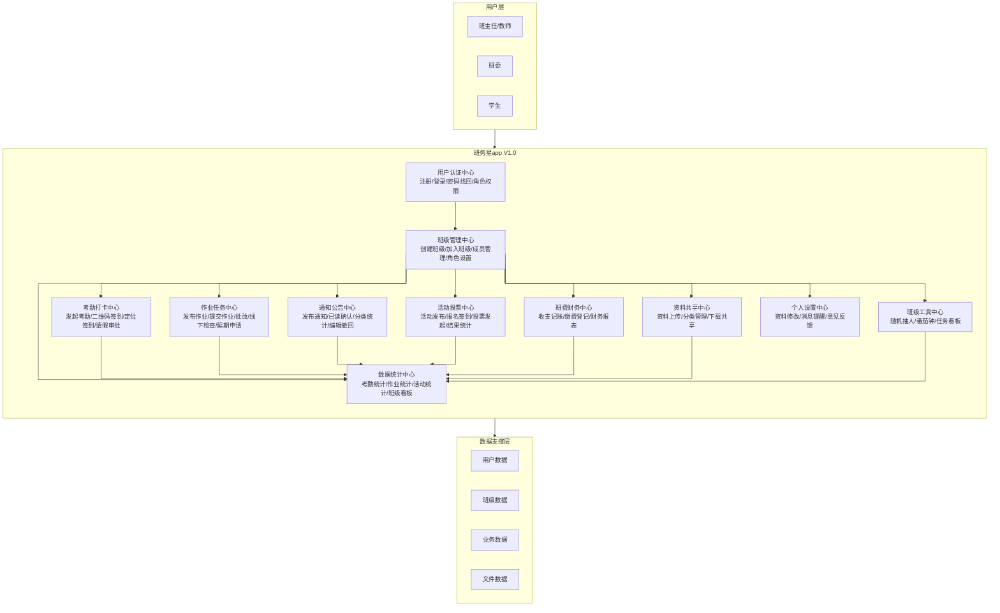
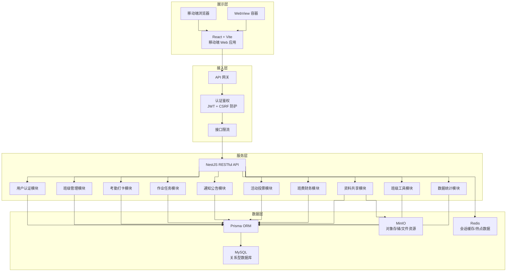

# 班务星app V1.0 系统架构图

## 一、系统功能架构图

## 二、系统技术架构图

## 三、架构设计说明

### 1. 系统功能架构图

功能架构图采用**三层结构**进行组织：

- **用户层**：明确区分班主任/教师、班委、学生三类核心角色，体现多角色权限设计。
- **功能模块层**：按照实际业务划分为 11 个功能中心，涵盖班级事务管理的完整闭环。班级管理中心作为核心枢纽，与其他业务模块形成星型关联；各业务模块的数据最终汇聚至数据统计中心，形成班级事务全局视图。
- **数据支撑层**：抽象为四类数据，分别支撑用户、班级、业务、文件资源，体现数据分类管理思想。

### 2. 系统技术架构图

技术架构图采用**分层架构**进行展示：

- **展示层**：基于 React + Vite 开发的移动端 Web 应用，可通过手机浏览器或 WebView 容器运行，实现跨平台访问。
- **接入层**：通过 API 网关统一接收前端请求，经过 JWT 认证鉴权、CSRF 防护和接口限流后转发至后端服务。
- **服务层**：采用 NestJS 框架构建 RESTful API，按业务领域拆分为多个独立模块，便于后续扩展维护。
- **数据层**：MySQL 作为关系型数据库负责业务数据持久化，通过 Prisma ORM 进行数据访问；Redis 负责会话缓存与热点数据加速；MinIO 负责文件、图片等对象资源的存储。

前后端之间通过 JSON 格式进行数据交换，整体架构清晰、职责分明，符合前后端分离的 B/S 架构设计原则。
